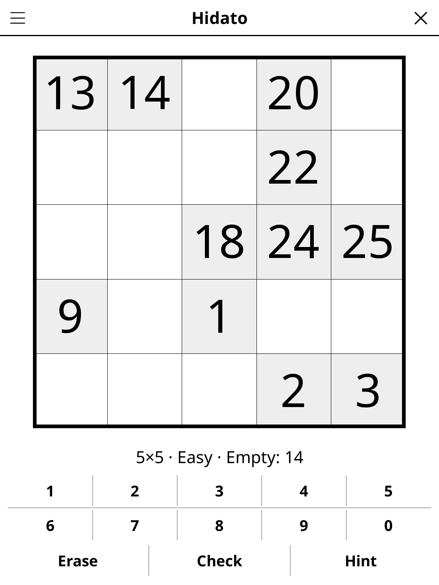

# hidato.koplugin

A Hidato puzzle plugin for [KOReader](https://github.com/koreader/koreader).

## Screenshot

## Rules

Fill the grid with consecutive numbers 1 to N. Each pair of consecutive numbers must occupy cells that are orthogonally or diagonally adjacent — trace a connected path from 1 to N through all cells.

## Features

- **Two grid sizes** — 5×5 and 6×6
- **Three difficulty levels** — Easy, Medium, Hard; every puzzle has one solution and can be solved by logic alone, no guessing (Easy needs only the simple steps, Hard shows the fewest numbers)
- **Check** — marks the numbers you placed that are wrong and counts the empty cells
- **Hint** — two taps: the first says which cell is about to give, the second acts on it. A cell that contradicts the solution is always reported before a fresh one is revealed
- **Auto-save** — puzzle state saved and restored on next launch

## Installation

1. Download `hidato.koplugin.zip` from the [latest release](../../releases/latest).
2. Extract into the `plugins/` folder of your KOReader data directory.
3. Restart KOReader.
4. Open the menu → **Tools** → **Hidato**.

## Controls

| Action | How |
|--------|-----|
| Select a cell | Tap it |
| Enter a number | Tap the digit button |
| Erase a cell | Tap **Erase** |
| Check progress | Tap **Check** |
| New puzzle | Tap **New** |
| Show rules | Tap **Rules** |

## License

GPL-3.0 — see [LICENSE](LICENSE).
